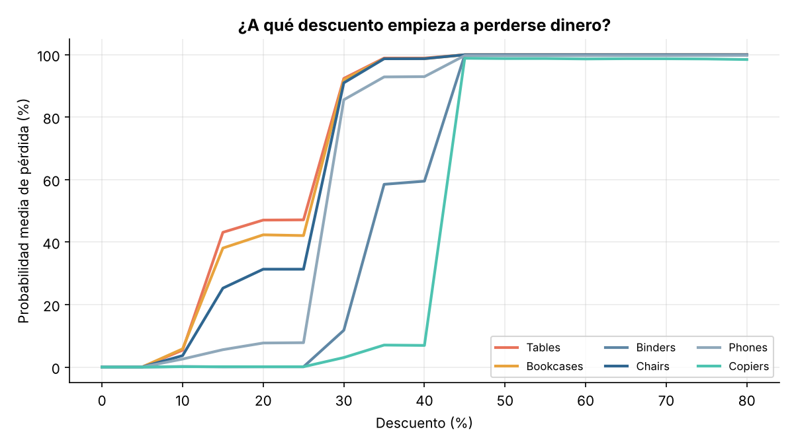
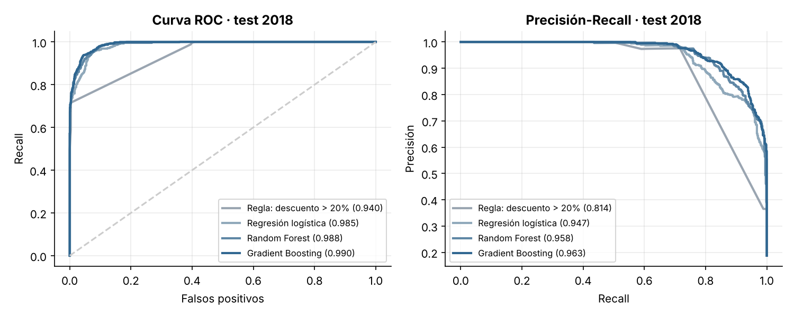
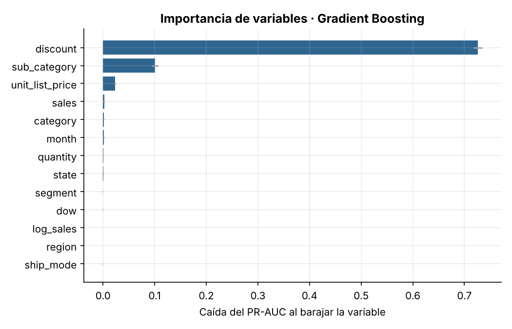
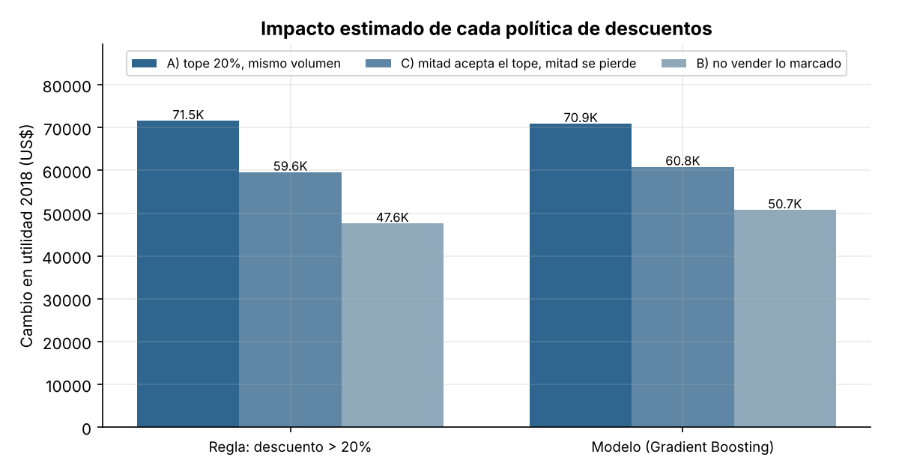
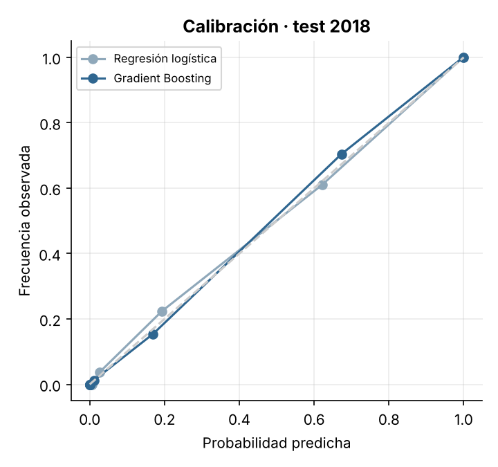

# Superstore — Predicción de pedidos con pérdida (Machine Learning)

[Read in English](README.md)

Un clasificador que indica **qué líneas de pedido terminarán con pérdida antes de aprobar el descuento**, más una simulación de cuánto valdría actuar sobre eso. Es la continuación predictiva de mi [dashboard de Superstore en Power BI](https://github.com/damarizvera/superstore-powerbi-dashboard), donde los descuentos sobre 20% resultaron ser el principal motor de pérdidas.



## Resultados (año 2018 reservado, 3.312 líneas, 18,7% con pérdida)

| Modelo | ROC-AUC | PR-AUC | F1 | F1 en la "zona gris"* |
|---|---|---|---|---|
| Regla: descuento > 20% (línea base) | 0,940 | 0,814 | 0,826 | 0,594 |
| Regresión logística | 0,985 | 0,947 | 0,842 | 0,663 |
| Random Forest | 0,988 | 0,958 | 0,868 | 0,735 |
| **Gradient Boosting (elegido)** | **0,990** | **0,963** | **0,881** | **0,754** |

\*Líneas con descuento entre 0% y 40%, donde un umbral simple no basta (1.415 líneas, 22% con pérdida).

**Lectura honesta:** casi toda la señal es el descuento, así que una regla de una línea ya es una base fuerte. El valor del modelo está donde la regla es ciega: recupera 70% de las pérdidas de la zona gris (regla: 44%) porque el descuento de equilibrio depende de la subcategoría (Tables, Bookcases y Chairs empiezan a perder entre 10% y 15%; Copiers y Phones toleran ~25–40%).

## Simulación de negocio (2018, supuestos explícitos)

Las líneas marcadas se reprecian con un tope de descuento de 20%. Cambio de utilidad vs lo ocurrido (utilidad real 2018: US$93.439):

| Política | Líneas marcadas | Con pérdida real | A) Tope, mismo volumen | C) Mitad acepta, mitad se va | B) No vender lo marcado |
|---|---|---|---|---|---|
| Regla: descuento > 20% | 455 | 444 | +US$71,5K | +US$59,6K | +US$47,6K |
| Gradient Boosting | 572 | 525 | +US$70,9K | +US$60,8K | +US$50,7K |

El modelo y la regla son **económicamente similares**; el modelo marca más líneas y gana cuando el cliente se va, mientras la regla es más simple de explicar. El escenario A supone que el cliente igual compra al precio con tope (optimista); B es el piso conservador. Son estimaciones what-if sobre datos históricos, no efectos causales.

## Enfoque

- **Objetivo:** `profit < 0` por línea de pedido. **Variables conocidas al aprobar:** descuento, cantidad, venta, precio de lista implícito, categoría, subcategoría, segmento, región, estado, modo de envío, mes y día de la semana. Se excluyeron `profit`, margen y fechas de envío (fuga de información).
- **Validación temporal:** umbrales elegidos entrenando 2015–16 y validando 2017; modelos finales entrenados 2015–17 y probados una sola vez en 2018. Sin split aleatorio, para que el futuro no contamine el entrenamiento.
- **Desbalance:** 18,7% de positivos; se evalúa con PR-AUC, precisión/recall y F1, no con accuracy.
- **Interpretabilidad:** importancia por permutación (descuento ≫ subcategoría ≫ precio de lista), curvas por subcategoría y calibración.

| | |
|---|---|
|  |  |
|  |  |

## Limitaciones

- Una sola tienda y cuatro años; es un dataset público de ejemplo, así que ilustra el método, no una empresa real.
- Sin costo de producto, la "pérdida" se infiere de `profit`; el modelo no ve por qué se perdió, solo con qué se correlaciona.
- El efecto de los descuentos sobre la demanda se supone, no se estima (ver escenarios).
- Casi toda la señal es el descuento, por lo que el modelo debe complementar una política de descuentos, no reemplazarla.

## Reproducir

```bash
pip install -r requirements.txt
python src/prepare_data.py   # limpia data/raw/superstore.csv -> data/processed/orders.csv
python src/train.py          # entrena, evalúa y simula; escribe reports/ y models/
```

Datos: dataset público "Sample - Superstore".
